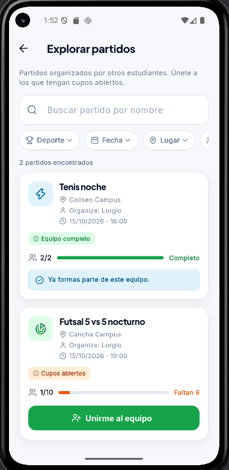
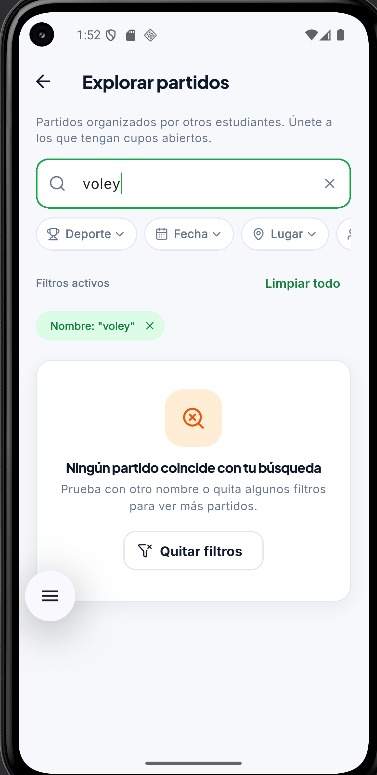

# Clase 15 · Heurísticas de Nielsen — Evidencia

**Proyecto:** UniSport · **Acción evaluada:** Encontrar un partido y unirse

**Recorrido:** Iniciar sesión (Diego) → Mis partidos → Explorar partidos → buscar → Unirme al equipo.
**Caso permitido:** unirse a un partido con cupos abiertos y fecha futura.
**Caso bloqueado:** unirse a un partido con equipo completo ("Convocatoria cerrada: el equipo ya está completo.").

| # | Pantalla y evidencia | Problema y consecuencia | Heurística | Severidad |
| :-: | :--- | :--- | :--- | :-: |
| 1 |  *Mis partidos*: "Explorar partidos para unirme" está dentro de esta pantalla; la barra inferior de la portada solo tiene "Inicio" y "Mis partidos". | Buscar partidos de otros no está en la navegación principal. Hay que saber que está dentro de "Mis partidos", así que un estudiante nuevo puede no encontrar dónde unirse. | **H6 Reconocimiento:** la opción depende de recordar dónde está, en vez de estar visible. | 2 |
| 2 |  *Explorar*: tras tocar "Unirme al equipo", "Tenis noche" muestra "Ya formas parte de este equipo" sin opción de salir (y quedó 2/2, equipo completo). | La unión no pide confirmación y no existe "Salir del partido". Si se equivoca, queda inscrito y ocupa un cupo que otro necesita, e incluso puede completar el equipo. | **H3 Control y libertad:** no hay salida para una acción tomada por error (también H5 Prevención). | 3 |
| 3 |  *Explorar* → buscar `voley` → "Ningún partido coincide con tu búsqueda". Un partido titulado "Vóley…" no aparecería, porque se compara con tilde. | La búsqueda distingue tildes. En el celular se escribe sin tildes ("voley", "futbol"), así que la app dice que no hay partidos aunque existan, y la tarea fracasa al inicio. | **H2 Mundo real:** exige escribir como está guardado, no como lo escribe la gente. | 3 |

## Hallazgo elegido: #1

**Por qué:** es la puerta de entrada a toda la tarea. Si el estudiante no descubre dónde están los partidos de otros, no llega a buscar ni a unirse, y los otros dos hallazgos ni siquiera llegan a ocurrir. Afecta a todos los usuarios nuevos en su primer uso, justo cuando deciden si la app les sirve.

**Mejora a iniciar:** hacer visible "Explorar" en la navegación principal.
- Interfaz: agregar la pestaña **"Explorar"** (ícono de brújula) a la barra inferior, junto a "Inicio" y "Mis partidos".
- Código: la pestaña abre *Explorar partidos*; sin sesión, redirige al login con el mensaje "Inicia sesión para explorar partidos".
- Prueba: desde la portada, tocar "Explorar" lleva a la lista de partidos de otros estudiantes.

| Antes | Después |
| :-: | :-: |
|  |  |
| "Explorar" solo como botón dentro de *Mis partidos* y un ícono arriba. | Pestaña **Explorar** en la barra inferior, siempre visible. |

**Estado: implementada.**
- Portada: barra inferior `Inicio | Explorar | Mis partidos` ([`vista_inicio_publico.dart`](../lib/vistas/vista_inicio_publico.dart), función `_alSeleccionarPestana`).
- *Mis partidos*: nueva barra inferior `Explorar | Mis partidos`, en el mismo orden que la portada (H4 Consistencia). Se quitó el ícono de brújula de la barra superior para no repetir la misma acción tres veces (H8 Minimalismo).
- Pruebas: `flutter test test/navegacion_explorar_test.dart` (la pestaña es visible, lleva a Explorar con sesión, redirige al login sin sesión y aparece también en *Mis partidos*).

---

*Severidad (Nielsen): 0 no es problema · 1 cosmético · 2 menor · 3 mayor · 4 catastrófico.*
