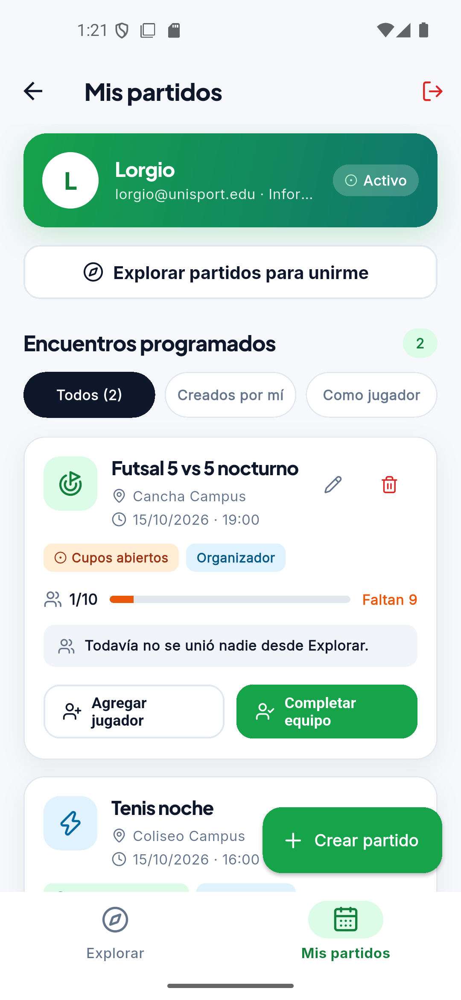
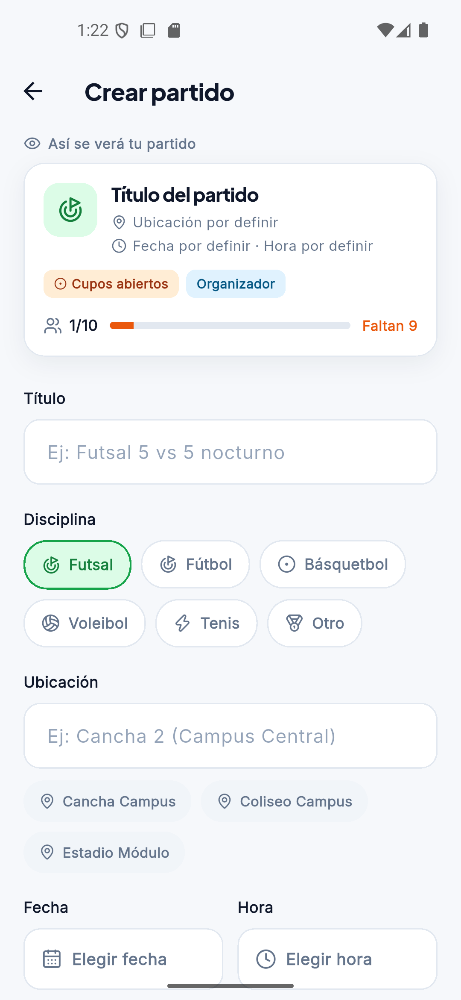
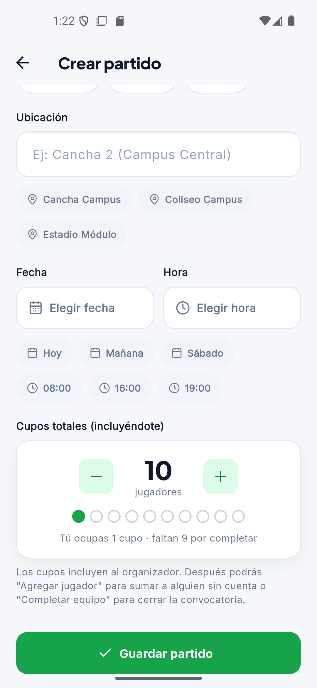

# Clase 16 · Decisiones de interacción — Hallazgos

**Proyecto:** UniSport · **Funcionalidad evaluada:** gestionar y crear partidos (organizador) y unirse con filtros de cupos, zona y fecha.
**Cómo se capturó:** app Android real (emulador) conectada a la base de datos de Supabase, cuenta `lorgio@unisport.edu` (organizador).

| Hallazgo | Captura obligatoria | Justificación breve | Estado al terminar |
| :--- | :--- | :--- | :--- |
| **Fitts** · alcanzar |  *Mis partidos* → tarjeta "Futsal 5 vs 5 nocturno": editar (lápiz) y eliminar (papelera) son íconos de 16 px en la esquina superior derecha. | **Tamaño y distancia:** los íconos miden 16 px con un área de 32×32, menor que los 48 px recomendados para el dedo, y están arriba a la derecha, lejos de las demás acciones de la tarjeta ("Agregar jugador", "Completar equipo", abajo). **Área activa:** editar y eliminar están pegados; queriendo editar es fácil tocar eliminar, la acción destructiva. | **Documentado** · prioritario |
| **Hick** · elegir |   *Crear partido*: 6 deportes, 3 atajos de lugar, 3 de fecha y 3 de hora, además de los campos y selectores. | **Cantidad:** antes de guardar, la persona recorre unas 15 opciones con el mismo peso visual. **Agrupación y prioridad:** "Futsal" y "Fútbol" usan el mismo ícono y obligan a comparar dos opciones casi iguales; los atajos de fecha y hora aparecen todos a la vez, aunque solo se usa uno de cada grupo. | Documentado |
| **Carga cognitiva** · comprender |  *Mis partidos* (16/10): el partido dice "15/10/2026 · 19:00" y sigue mostrando "Cupos abiertos" con sus botones activos. | **Interpretar y comparar:** la fecha se muestra solo en formato absoluto; para saber si el partido es hoy, mañana o si ya pasó, la persona tiene que recordar la fecha actual y compararla. En la captura el partido ya se jugó, pero nada en la tarjeta lo dice. | Documentado |

## Prioridad: Fitts

Se corrige primero porque el error tiene el costo más alto: tocar **eliminar** por accidente borra un partido con sus inscripciones. Además, editar y eliminar son las acciones que el organizador usa sobre cada partido, y hoy son las más difíciles de alcanzar de toda la tarjeta.

**Decisión de diseño:** convertir los dos íconos en botones con texto, del ancho de la tarjeta, junto a las demás acciones del partido. Separar eliminar de editar y darle color de advertencia para que no se confundan.

*Los hallazgos de Hick y carga cognitiva quedan documentados para una siguiente iteración.*
