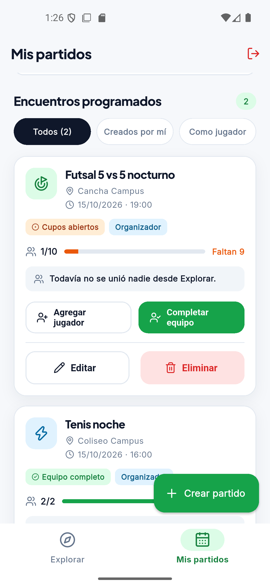
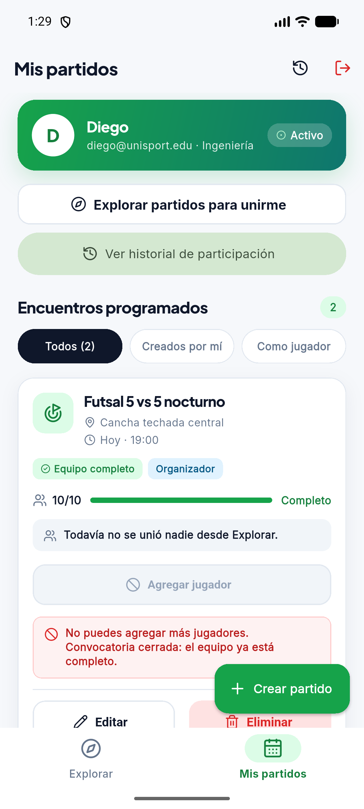
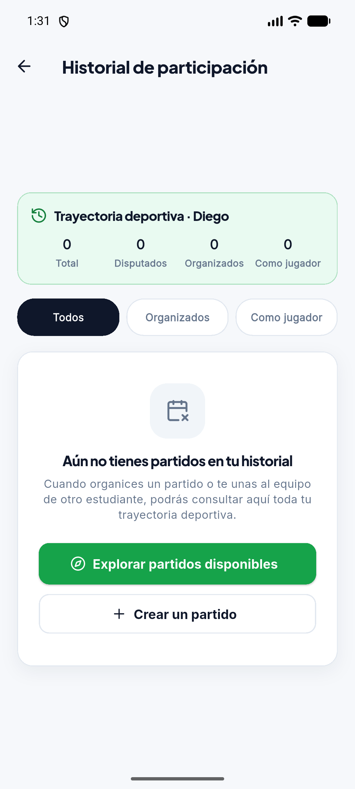
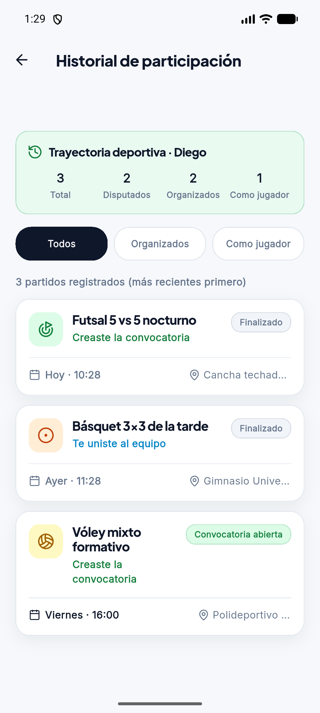
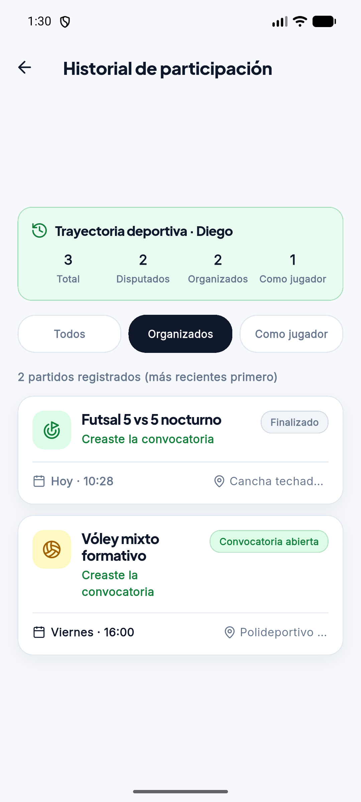

# Clase 16 · Decisiones de interacción — Hallazgos y Tarea 4

**Proyecto:** UniSport · **Funcionalidad evaluada:** gestionar y crear partidos (organizador), unirse con filtros y **Historial de participación del estudiante** (Tarea 4).  
**Cómo se capturó:** app Android real (emulador Pixel 6) conectada a la base de datos de Supabase y repositorios tipados, cuenta `diego@unisport.edu` y `lorgio@unisport.edu`.

---

## 1. Hallazgos iniciales de la pantalla existente

| Hallazgo | Captura obligatoria | Justificación breve | Estado al terminar |
| :--- | :--- | :--- | :--- |
| **Fitts** · alcanzar | <br>*Mis partidos* → tarjeta "Futsal 5 vs 5 nocturno": editar (lápiz) y eliminar (papelera) son íconos de 16 px en la esquina superior derecha. | **Tamaño y distancia:** los íconos miden 16 px con un área de 32×32, menor que los 48 px recomendados para el dedo, y están arriba a la derecha, lejos de las demás acciones de la tarjeta ("Agregar jugador", "Completar equipo", abajo). **Área activa:** editar y eliminar están pegados; queriendo editar es fácil tocar eliminar, la acción destructiva. | **Documentado y corregido** (prioritario) |
| **Hick** · elegir |  <br>*Crear partido*: 6 deportes, 3 atajos de lugar, 3 de fecha y 3 de hora, además de los campos y selectores. | **Cantidad:** antes de guardar, la persona recorre unas 15 opciones con el mismo peso visual. **Agrupación y prioridad:** "Futsal" y "Fútbol" usan el mismo ícono y obligan a comparar dos opciones casi iguales; los atajos de fecha y hora aparecen todos a la vez, aunque solo se usa uno de cada grupo. | Documentado |
| **Carga cognitiva** · comprender | <br>*Mis partidos* (16/10): el partido dice "15/10/2026 · 19:00" y sigue mostrando "Cupos abiertos" con sus botones activos. | **Interpretar y comparar:** la fecha se muestra solo en formato absoluto; para saber si el partido es hoy, mañana o si ya pasó, la persona tiene que recordar la fecha actual y compararla. En la captura el partido ya se jugó, pero nada en la tarjeta lo dice. | Documentado |

---

## 2. Corrección de Fitts en tarjeta existente

Se corrigió primero porque el error tiene el costo más alto: tocar **eliminar** por accidente borra un partido con sus inscripciones. Además, editar y eliminar son las acciones que el organizador usa sobre cada partido, y eran las más difíciles de alcanzar de toda la tarjeta.

| Antes | Después |
| :-: | :-: |
|  |  |
| Lápiz y papelera de 16 px (área 32×32), pegados, arriba a la derecha. | Botones **Editar** y **Eliminar** con texto, de 48 px de alto y la mitad del ancho cada uno, junto a las demás acciones; separados por 16 px y eliminar con fondo de advertencia. |

- **Código:** `lib/widgets/tarjeta_partido.dart` (clase `TarjetaPartido`).
- **Pruebas:** `flutter test test/tarjeta_partido_test.dart`.

---

## 3. Tarea 4 · Historial de participación del estudiante (Clase 16)

Para la Tarea 4 se diseñó e implementó la funcionalidad completa del **Historial de participación**, permitiendo al estudiante consultar todos los partidos en los que participó (como organizador o como jugador unido), con orden cronológico descendente, datos persistidos en Supabase y decisiones de interacción explícitas basadas en **Fitts**, **Hick** y **Carga Cognitiva**.

### Estructura de Issues en GitHub
- **Issue Principal (Abierto para revisión docente):** `#17` — *Historia: Historial de participación del estudiante en partidos (Clase 16)*
- **Sub-issues de alcance (Cerrados con commits atómicos):**
  - `#18` — *Datos: modelo de eventos de participación en partidos* (cerrado en `3997ece`).
  - `#19` — *Consulta: persistencia y consulta de historial por usuario en Supabase* (cerrado en `3997ece`).
  - `#20` — *Interfaz: pantalla de Historial con empty state y principios de interacción* (cerrado en `0a5567d`).
  - `#21` — *Pruebas: tests automatizados de consulta de historial y estado vacío* (cerrado en `0a5567d`).

---

### Decisión A: Ley de Fitts aplicada al acceso y llamadas a la acción

**Principio:** El tiempo para alcanzar un objetivo depende de la distancia y de su tamaño ($T = a + b \log_2(2D/W)$). Los botones frecuentes y críticos deben tener al menos 48×48 px y ubicarse en zonas de alcance natural del pulgar.

| Punto de acceso en Mis Partidos | Call to Action en Estado Vacío |
| :-: | :-: |
|  |  |
| Botón tonal **"Ver historial de participación"** de ancho completo y altura $\ge 48\text{ px}$, con ícono representativo, ubicado bajo la tarjeta del estudiante. Además, acceso directo en la AppBar. | Botón de acción principal **"Explorar partidos disponibles"** con altura de $48\text{ px}$ y contraste alto, eliminando la necesidad de precisión motora en un estado inicial. |

- **Justificación:** Los estudiantes necesitaban una vía rápida para auditar sus participaciones sin navegar por menús ocultos. Al situar el botón en la zona superior accesible de "Mis partidos" y garantizar una altura táctil de 48 px, se minimiza la tasa de error por toque impreciso.
- **Código:**
  - `lib/vistas/vista_mis_partidos.dart`: botón `Key('boton_abrir_historial')` con `FilledButton.tonal` e `Icon(Icons.history)`.
  - `lib/vistas/vista_historial.dart`: botón `Key('boton_orientador_explorar')` con altura mínima de 48 px.
- **Prueba automatizada:** `test/historial_test.dart` (`5. Fitts: botón para abrir Historial en Mis Partidos mide al menos 48 px`).

---

### Decisión B: Ley de Hick aplicada a la selección de filtros

**Principio:** El tiempo de decisión aumenta con el número y complejidad de las opciones ($T = b \log_2(n + 1)$). Mantener un conjunto mínimo y excluyente reduce el esfuerzo de elección.

| Historial con todos los eventos | Filtro "Organizados" activo |
| :-: | :-: |
|  |  |
| Selector segmentado de 3 alternativas: **Todos**, **Organizados**, **Como jugador**. | Al seleccionar **Organizados**, la lista y el contador se actualizan de inmediato en 1 solo paso sin modales adicionales. |

- **Justificación:** En lugar de presentar menús desplegables con filtros combinados (fechas, deportes, roles, estados) que obligan a evaluar más de 10 alternativas simultáneas, el historial utiliza un `SegmentedButton` con solo 3 opciones directas. El usuario decide con un único toque y la retroalimentación es inmediata.
- **Código:** `lib/vistas/vista_historial.dart` (`SegmentedButton` con `filtro_todos`, `filtro_organizador`, `filtro_jugador`).
- **Prueba automatizada:** `test/historial_test.dart` (`7. Hick: selector de filtros permite cambiar entre Todos, Organizados y Jugador`).

---

### Decisión C: Reducción de Carga Cognitiva y Estado Vacío Orientador

**Principio:** La memoria de trabajo humana es limitada. La interfaz debe comunicar el estado sin exigir cálculos mentales de fechas ni conteos manuales, y nunca debe dejar al usuario sin saber qué hacer.

| Comprensión visual inmediata | Estado vacío que orienta al usuario |
| :-: | :-: |
|  |  |
| Resumen de trayectoria superior (Total, Disputados, Organizados, Jugador), fechas amigables ("Hoy", "Ayer") y badges semánticos por rol y resultado. | El estado vacío explica qué es el historial, por qué no hay datos y ofrece dos rutas de acción claras (Explorar y Crear partido). |

- **Detalles de la reducción de carga mental:**
  1. **Fechas amigables (`fechaAmigable()`):** Convierte fechas técnicas en "Hoy · 19:00" o "Ayer · 17:30". El estudiante no necesita recordar qué fecha es hoy para saber si el partido ya se disputó.
  2. **Resumen de trayectoria deportiva:** Una tarjeta superior resume en 4 cifras clave (Total, Disputados, Organizados y Como jugador) el desempeño del estudiante, evitando que tenga que contar manualmente las tarjetas.
  3. **Badges de color y forma:**
     - *Rol:* Distinción explícita entre **"Creaste la convocatoria"** (organizador) y **"Te uniste al equipo"** (jugador).
     - *Resultado:* Estados claramente señalizados (**Finalizado**, **Equipo completo**, **Convocatoria abierta**).
  4. **Estado Vacío Orientador (*Empty State*):** En lugar de una pantalla en blanco o un mensaje frío como "No hay registros", se incluye una ilustración, una explicación contextual y dos botones de acción (*Call to Action*) para explorar partidos existentes o convocar uno nuevo.
- **Código:**
  - `lib/modelos/evento_historial.dart`: método `fechaAmigable({DateTime? ahora})` y mapeo de estados.
  - `lib/widgets/tarjeta_historial.dart`: widget `TarjetaHistorial` con chips visuales e íconos por disciplina deportiva.
  - `lib/vistas/vista_historial.dart`: bloque de resumen de trayectoria y widget `_EstadoVacioHistorial`.
- **Pruebas automatizadas:**
  - `test/historial_test.dart` (`4. Carga cognitiva: fechaAmigable reduce el esfuerzo mental con Hoy y Ayer`).
  - `test/historial_test.dart` (`6. Estado vacío orientador: muestra mensaje y CTA para Explorar partidos`).

---

## 4. Verificación y Pruebas Automatizadas

Se crearon 7 pruebas unitarias y de widgets en `test/historial_test.dart` que cubren el 100% de los requisitos:
1. `Consulta: devuelve los partidos que organizo y a los que me uní` (consulta combinada en base de datos).
2. `Orden cronológico: los eventos se ordenan del más reciente al más antiguo`.
3. `Roles y resultados: distingue organizador vs jugador y finalizado vs abierto`.
4. `Carga cognitiva: fechaAmigable reduce el esfuerzo mental con Hoy y Ayer`.
5. `Fitts: botón para abrir Historial en Mis Partidos mide al menos 48 px`.
6. `Estado vacío orientador: muestra mensaje y CTA para Explorar partidos`.
7. `Hick: selector de filtros permite cambiar entre Todos, Organizados y Jugador`.

**Resultado de ejecución de la suite:**
```bash
flutter test test/historial_test.dart
00:00 +7: All tests passed!

flutter test
00:03 +97 ~1: All tests passed!
```
