# Evaluación heurística H1–H10 · UniSport

**Issue principal:** #12 · **Sub-issues:** #13 (H3/H5), #14 (H2), #15 (H7), #16 (H10)
**Flujo evaluado:** registrarse → Mis partidos → Crear partido → Explorar → buscar y filtrar → Unirme al equipo → Salir del partido.
**Cómo se capturó:** la app web real (`flutter build web`) abierta en Brave con tamaño de celular (390×844), conectada a la base de datos de Supabase. Las capturas "antes" salen de la versión del commit `28aa6b1` (anterior a las correcciones) y las "después" de la versión actual.
**Severidad (Nielsen):** 0 no es problema · 1 cosmético · 2 menor · 3 mayor · 4 catastrófico.

## Resumen

| H | Heurística | Resultado | Sub-issue / commit |
| :-: | :--- | :--- | :-: |
| H1 | Visibilidad del estado del sistema | **Cumple** | – |
| H2 | Relación con el mundo real | **Corregida** (búsqueda sin tildes) | #14 · a59b50d |
| H3 | Control y libertad | **Corregida** (Salir del partido + cancelar) | #13 · 14edac8 |
| H4 | Consistencia y estándares | **Cumple** | – |
| H5 | Prevención de errores | **Corregida** (confirmar antes de unirse) | #13 · a9f9edb |
| H6 | Reconocer antes que recordar | **Corregida** (pestaña Explorar) | 28aa6b1 |
| H7 | Flexibilidad y eficiencia | **Corregida** (el filtro se conserva) | #15 · a9f9edb |
| H8 | Diseño estético y minimalista | **Cumple** | – |
| H9 | Reconocer y recuperarse de errores | **Cumple** | – |
| H10 | Ayuda y documentación | **Corregida** (ayuda en Crear partido) | #16 · a59b50d |

## Detalle

### H1 · Visibilidad del estado del sistema — Cumple
- **Dónde y cómo se comprobó:** tras crear un partido aparece el aviso «Partido "Futsal viernes" creado y guardado» y el contador de la lista sube a 2; al unirse, el contador de cupos cambia (2/10 → 3/10) y se muestra «Ya formas parte de este equipo.»; la sesión se conserva y la app abre directo en *Mis partidos* con el estudiante «Activo».
- **Capturas:** [aviso al crear](evidencias/h1-snackbar-partido-creado.png) · [sesión persistente](evidencias/h1-sesion-persistente-abre-en-mis-partidos.png)
- **Código:** `lib/vistas/vista_mis_partidos.dart` (`_crearPartido`, SnackBar), `lib/vistas/vista_explorar_partidos.dart` (`_unirse`, `_avisar`), `lib/widgets/boton_accion.dart`, `lib/widgets/tarjeta_partido.dart`.

### H2 · Relación con el mundo real — Corregida (sev. 3) → #14
- **Problema (antes):** al buscar `voley` aparece «Ningún partido coincide con tu búsqueda» aunque existe «Vóley mixto»; la búsqueda distinguía tildes. En el celular casi nadie las escribe.
- **Corrección:** `FiltroPartidos.normalizar` y `coincideTitulo` comparan sin tildes ni mayúsculas, y el repositorio filtra el nombre en la app. Prueba: `test/filtro_partidos_test.dart` («H2: la búsqueda por nombre ignora tildes y mayúsculas»).
- **Archivos modificados:** `lib/modelos/filtro_partidos.dart`, `lib/servicios/repositorio_supabase.dart`, `test/filtro_partidos_test.dart`.
- **Antes:** 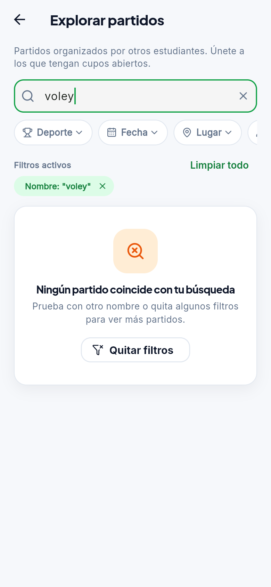 **Después:** 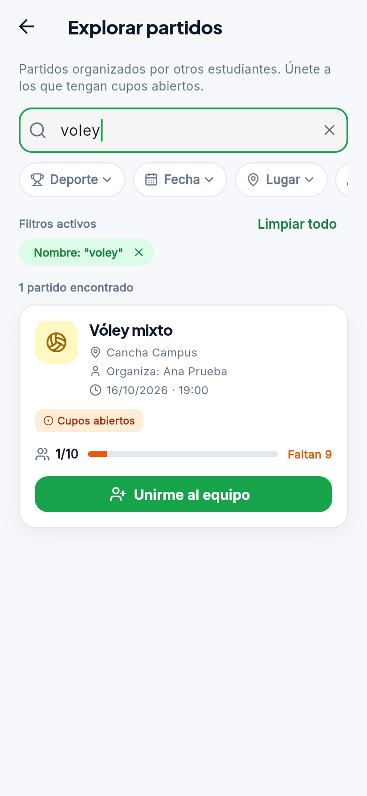

### H3 · Control y libertad — Corregida (sev. 3) → #13
- **Problema (antes):** al tocar «Unirme al equipo» no había forma de arrepentirse: no existía «Salir del partido», así que un toque equivocado ocupaba un cupo ajeno.
- **Corrección:** acción **Salir del partido** con confirmación («¿Salir del partido?» → Cancelar / Sí, salir), disponible en *Explorar* y en *Mis partidos → Como jugador*; libera el cupo y reabre la convocatoria. El organizador no puede salir de su propio partido ni se puede salir de un partido que ya pasó. Regla en el modelo (`salir`, `motivoRechazoSalir`) y también en el servidor (función `salir_del_partido` en `supabase/esquema.sql`).
- **Archivos modificados:** `lib/modelos/modelo_partido.dart`, `lib/servicios/repositorio_partidos.dart`, `lib/servicios/repositorio_supabase.dart`, `lib/vistas/vista_explorar_partidos.dart`, `lib/vistas/vista_mis_partidos.dart`, `lib/widgets/tarjeta_partido.dart`, `supabase/esquema.sql`, `test/union_partido_test.dart`, `test/explorar_filtros_test.dart`, `test/apoyo/repositorio_en_memoria.dart`.
- **Antes:** 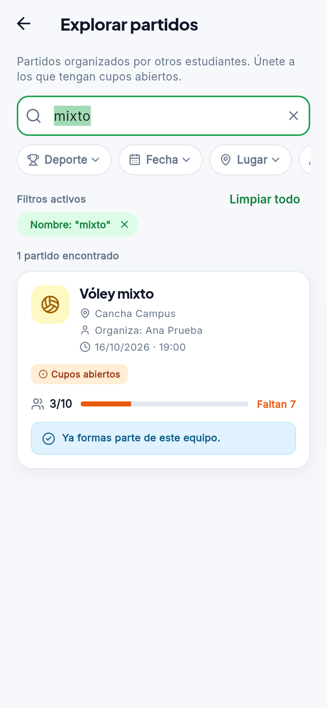 (queda unido, sin salida)
- **Después:** 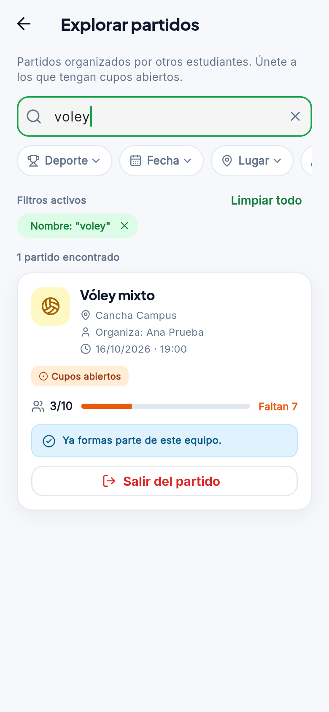 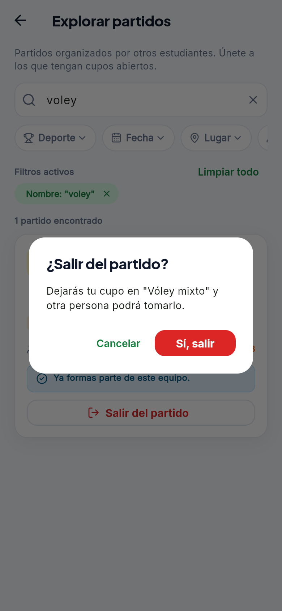

### H4 · Consistencia y estándares — Cumple
- **Cómo se comprobó:** la barra inferior es la misma en la portada (`Inicio | Explorar | Mis partidos`) y en *Mis partidos* (`Explorar | Mis partidos`), en el mismo orden; la acción de unirse se llama «Unirme al equipo» en todas las pantallas; los avisos usan los mismos colores (rojo = rechazo, azul = información).
- **Capturas:** [portada](evidencias/h4-portada.png) · [Mis partidos](evidencias/h4-mis-partidos-barra-explorar.png)
- **Código:** `lib/vistas/vista_inicio_publico.dart`, `lib/vistas/vista_mis_partidos.dart`, `test/navegacion_explorar_test.dart`.

### H5 · Prevención de errores — Corregida (sev. 3) → #13
- **Problema (antes):** «Unirme al equipo» se ejecutaba al primer toque, sin confirmar (la tarjeta pasa de 2/10 a 3/10 de inmediato).
- **Corrección:** diálogo «¿Unirte al equipo?» que indica el partido y los cupos, con Cancelar / Sí, unirme. Además se conserva la prevención ya existente: el servidor vuelve a validar las reglas y los botones se apagan o muestran el motivo cuando no aplican.
- **Archivos modificados:** `lib/vistas/vista_explorar_partidos.dart`, `test/explorar_filtros_test.dart`.
- **Antes:** 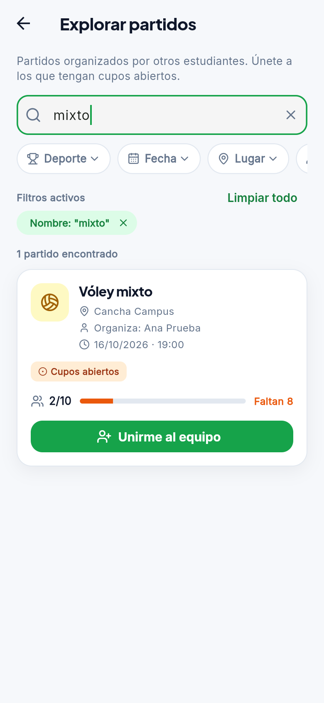 →  **Después:** 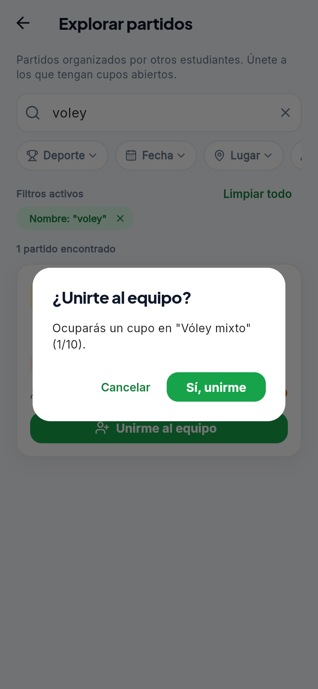

### H6 · Reconocer antes que recordar — Corregida (sev. 2)
- **Problema (antes):** «Explorar» solo estaba dentro de *Mis partidos*; la barra inferior de la portada tenía solo «Inicio» y «Mis partidos».
- **Corrección:** pestaña **Explorar** en la barra inferior de la portada y de *Mis partidos* (commit 28aa6b1, prueba `test/navegacion_explorar_test.dart`).
- **Antes:** 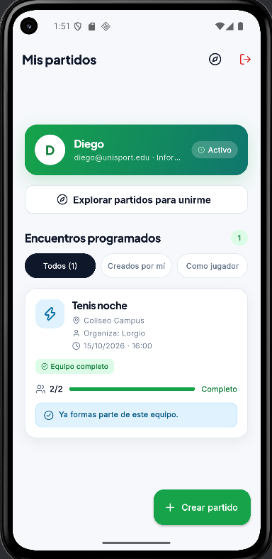 **Después:** 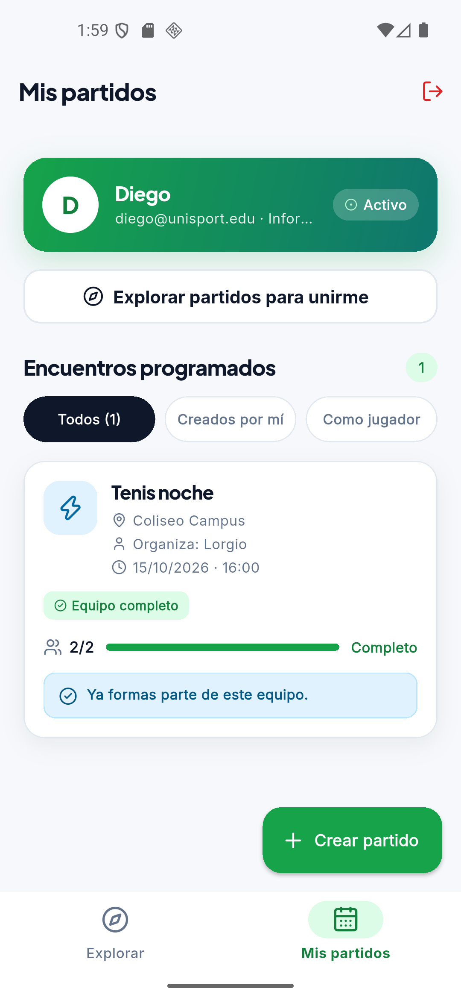 · [Explorar abierto desde la pestaña](evidencias/h6-explorar-despues.png)

### H7 · Flexibilidad y eficiencia — Corregida (sev. 1) → #15
- **Problema (antes):** al salir de *Explorar* y volver, la búsqueda y los filtros se perdían y había que repetirlos.
- **Corrección:** el filtro se guarda en `ServicioAutenticacion.filtroExplorar` y se reinicia al cerrar sesión. Prueba: `test/explorar_filtros_test.dart` («H7: el filtro se conserva al salir y volver a Explorar»).
- **Archivos modificados:** `lib/servicios/servicio_autenticacion.dart`, `lib/vistas/vista_explorar_partidos.dart`, `test/explorar_filtros_test.dart`.
- **Antes (volver a Explorar con filtro «voley» → búsqueda vacía):** 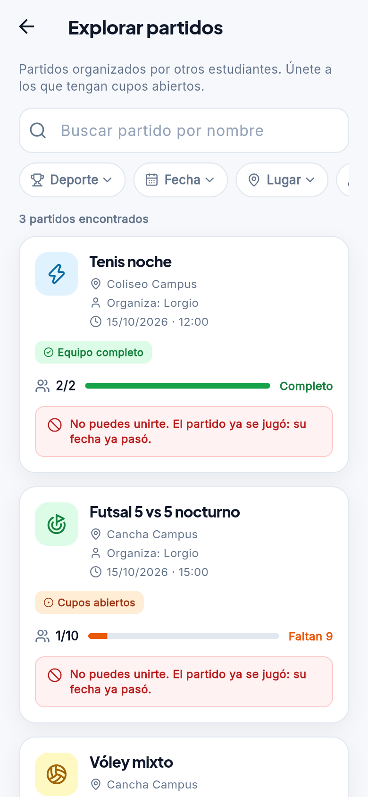 **Después (misma acción → sigue «voley»):** 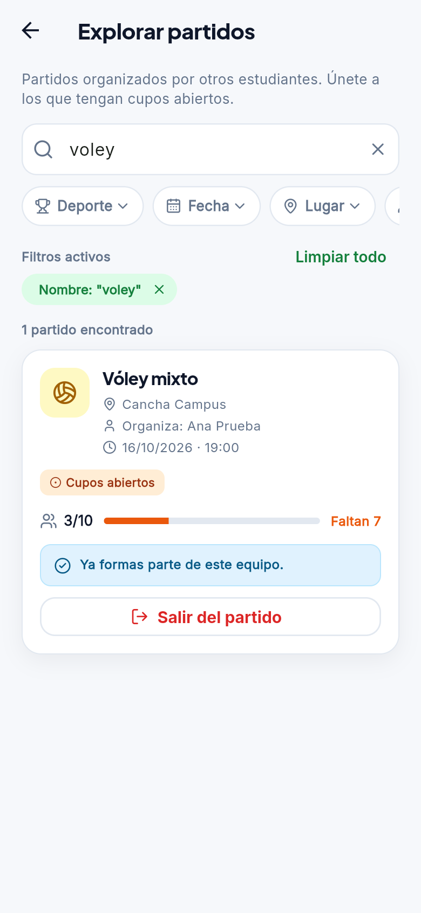

### H8 · Diseño estético y minimalista — Cumple
- **Cómo se comprobó:** en cada tarjeta de *Explorar* la acción principal «Unirme al equipo» es el único botón relleno de color y no compite con otros; las acciones secundarias del organizador (editar, eliminar) son íconos pequeños.
- **Capturas:** [tarjeta con acción principal](evidencias/h2-despues-busqueda-voley.png) · [acciones del organizador](evidencias/h1-snackbar-partido-creado.png)
- **Código:** `lib/widgets/tarjeta_partido.dart`, `lib/tema/tema_app.dart`.

### H9 · Reconocer y recuperarse de errores — Cumple
- **Cómo se comprobó:** cuando una acción se rechaza, el mensaje explica el motivo en lenguaje claro y la tarjeta no ofrece el botón: «No puedes unirte. El partido ya se jugó: su fecha ya pasó.»; otros motivos: «Convocatoria cerrada: el equipo ya está completo.» y «Ya formas parte de este equipo.». Sin conexión se muestra un mensaje propio.
- **Captura:** [rechazo con motivo](evidencias/h9-rechazo-con-motivo-claro.png)
- **Código:** `lib/modelos/modelo_partido.dart` (`motivoRechazoUnirse`), `lib/widgets/tarjeta_partido.dart`, `test/tarjeta_partido_test.dart`.

### H10 · Ayuda y documentación — Corregida (sev. 1) → #16
- **Problema (antes):** al elegir los cupos no se explicaba qué incluyen ni qué hacen «Agregar jugador» y «Completar equipo».
- **Corrección:** texto breve debajo del selector de cupos en *Crear partido*.
- **Archivo modificado:** `lib/vistas/vista_crear_partido.dart`.
- **Antes:** 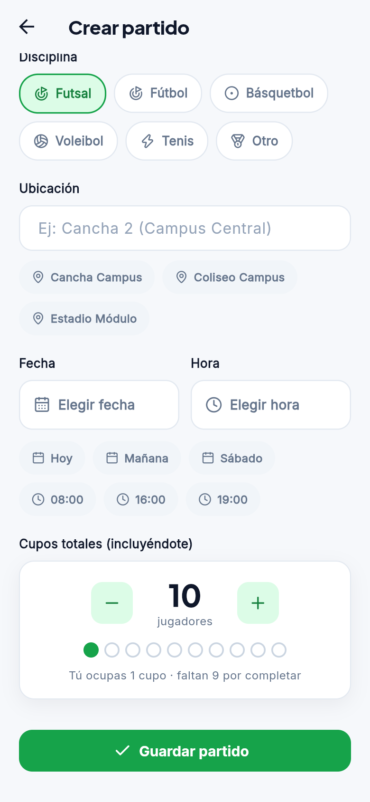 **Después:** 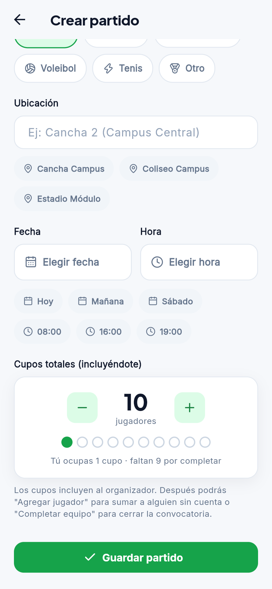
